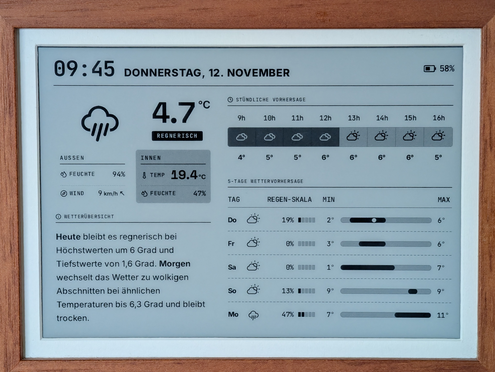
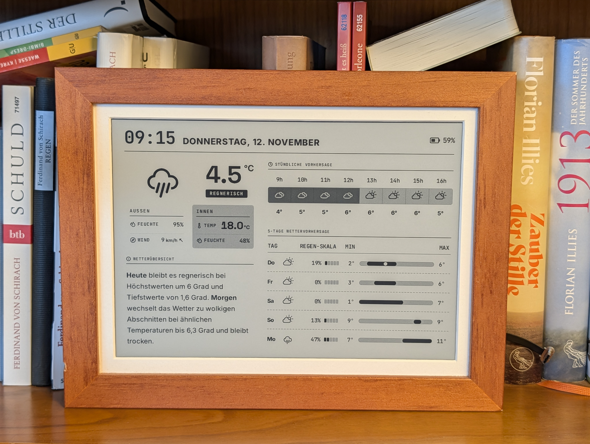
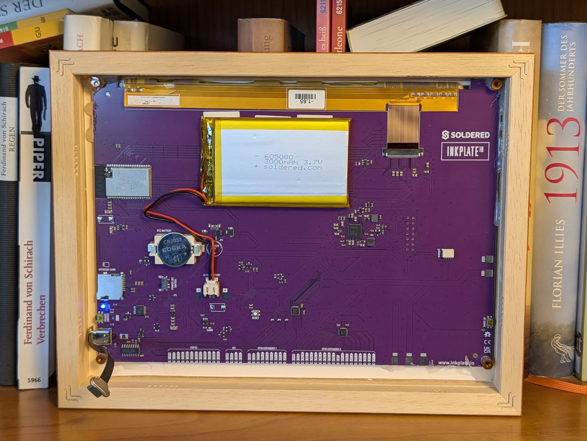

# E-Ink Weather Dashboard

A monochrome, 6-contrast-level weather dashboard built for the Inkplate 10 e-paper screen.
It connects to a local Home Assistant instance and serves a static image that can be displayed on the screen.

More fotos

## Prerequisites

- A local Home Assistant instance.
- An Inkplate 10 ESP32 board flashed with [Homeplate](https://github.com/lanrat/homeplate).
- A local Docker host running this compose project.

## Architecture

This repository bundles two services orchestrated via `docker-compose.yml`:

- `dashboard/`: Monochrome, 6-contrast-level e-ink weather dashboard (React, Vite, Express `/api/ha/*` proxy) served on port `3000`.
- `renderer/`: Headless Chromium + Sharp service (`eink-web-renderer`) that captures `http://dashboard:3000` on a cron schedule and serves the processed `1200 x 825` grayscale PNG on port `80` (mapped to container port `8080`) for the e-ink display.

The dashboard connects to a local Home Assistant instance and reads the required weather entities and sensors (or falls back to built-in mock scenarios if `HA_URL` / `HA_TOKEN` are not configured).
The renderer serves the static `1200 x 825` px PNG at `http://<docker-host-ip>/` on port `80`.
The [Homeplate](https://github.com/lanrat/homeplate) project running on the e-ink board is configured to fetch and render the static image at custom intervals.

## Run with Docker Compose

1. Copy `.env.example` to `.env` and configure your Home Assistant and renderer settings.
2. Build and start both containers:
   `docker compose up -d --build`
3. Access the dashboard preview at `http://localhost:3000` and the rendered PNG at `http://localhost` (port `80`).

## Run Dashboard Locally

**Prerequisites:** Node.js

1. `cd dashboard && npm install`
2. Configure `../.env` (or `.env` in `dashboard/`)
3. Run the app:
   `npm run dev` (if you want live Home Assistant data during Vite dev, also run `PORT=3001 node server.js` in `dashboard/`, as Vite proxies `/api` and `/config.js` to port `3001`)
4. Type-check and build:
   `npm run lint`
   `npm run build`
